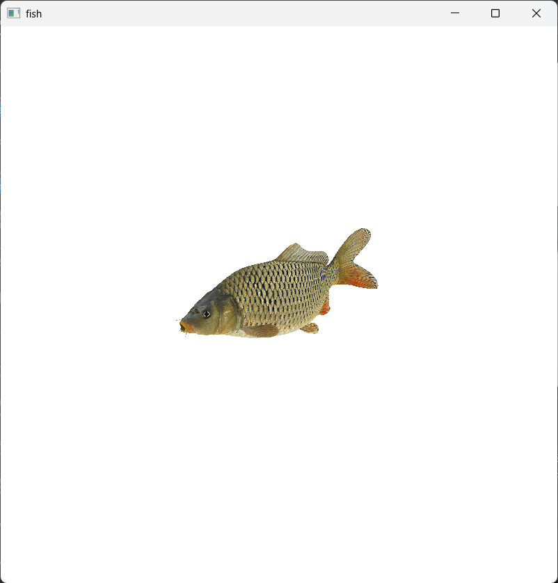
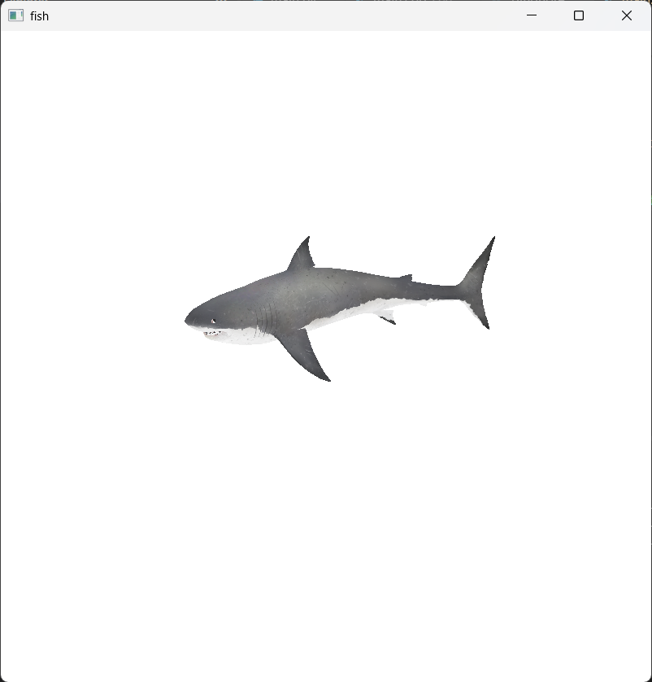
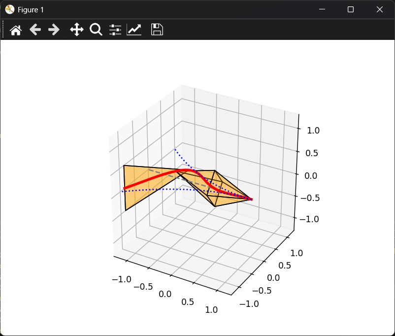

# Fish Movement

A small program that makes a 3D fish swim. It takes a fish model and bends it from side to side following a sine wave bounded by an Amplitude(x) function to mimic real life movement. 

<p align="center">
  
  
</p>

## How it works

1. A fish .obj file is loaded from the onjects folder. 
2. Every point on the fish gets a position `t` along its body: `0` at the nose, `1` at the tail.
3. Every moment, each point is pushed sideways by:
   ```
   offset = Amp(x) * sin(2π * (x / wl - freq * t))
   ```
   - `Amp(x)` is the amplitude at a certain x. Often small at the nose and big at the tail (ie `x^2`).
   - `wl` is the length of one wave along the body.
   - `freq` is how fast the waves travel, so how fast the fish swims.

4. A picture from the `skins` folder is wrapped on top.

`Amp`, `wl` and `freq` are all changeable to mimic different fish movement at [cpp/src/main.cpp](cpp/src/main.cpp).

## How to run

You need CMake, a C++ compiler and OpenGL. Run these from the project folder:

```
cmake -S . -B build
cmake --build build
./build/fish
```


## Python version

The original python version can be used to understand the process. Struggles to load larger models. 



```
pip install numpy matplotlib
python python/main.py
```
